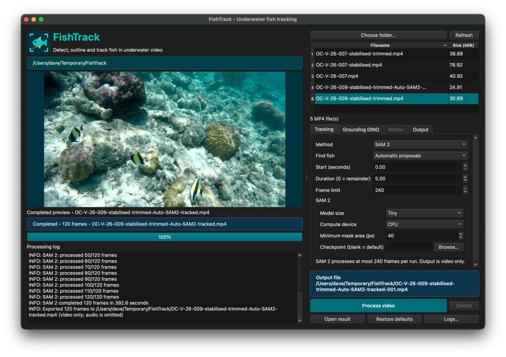

# Overview

**FishTrack** is an experimental, open-source Python desktop application for detecting, segmenting and tracking fish in recorded underwater video. It combines AI-based object detection and segmentation with conventional computer-vision techniques to explore the challenges of following individual fish through complex underwater environments.

The project grew out of a trip to the Maldives that produced around 50 GB of GoPro footage. Following the development of [ReefFrame](https://github.com/davewalker5/ReefFrame), which dehazes, enhances and stabilises underwater video, FishTrack was a natural next step: Rather than simply extracting interesting frames, could computer vision be used to find individual fish and follow their movements through the footage?

This is a surprisingly difficult problem. Underwater scenes contain complex backgrounds, changing illumination, suspended particles and moving vegetation. Camera movement introduces further complications, particularly when foreground and background objects appear to move at different rates. Fish themselves may change direction, overlap, disappear behind coral or become difficult to distinguish from their surroundings.

FishTrack provides an interactive workflow for experimenting with these challenges:

- **Fish detection:** Use _Grounding DINO_ to propose candidate fish regions from a starting frame, or select regions manually
- **Fish tracking:** Choose between conventional computer-vision tracking and _SAM 2_, allowing different approaches to be explored and compared
- **Segmentation:** Use _SAM 2_ to generate pixel-level masks representing the predicted extent of tracked fish
- **Video annotation:** Generate a separate annotated MP4 showing tracking results, without modifying the original footage
- **Interactive configuration:** Use the desktop interface to select video footage, review candidate regions, configure processing options and inspect results

FishTrack is intended as a tool for **experimentation, exploration and visual annotation**, rather than a validated system for species identification, population assessment or behavioural measurement. Detection and tracking results are algorithmic predictions and may be incorrect, particularly in challenging underwater scenes.

The project is also an opportunity to investigate how modern AI techniques such as _Grounding DINO_ and _SAM 2_ compare with more traditional computer-vision approaches when applied to real-world underwater footage.

## Getting Started

Please see the [Wiki](https://github.com/davewalker5/FishTrack/wiki) for the user guide, controls and further details.

## Authors

- **Dave Walker** - _Initial work_

## Feedback

To report an issue or suggest an improvement, please use the project's [GitHub Issues](https://github.com/davewalker5/FishTrack/issues) page.

## License

This project is licensed under the MIT License — see the [LICENSE](LICENSE) file for details.
